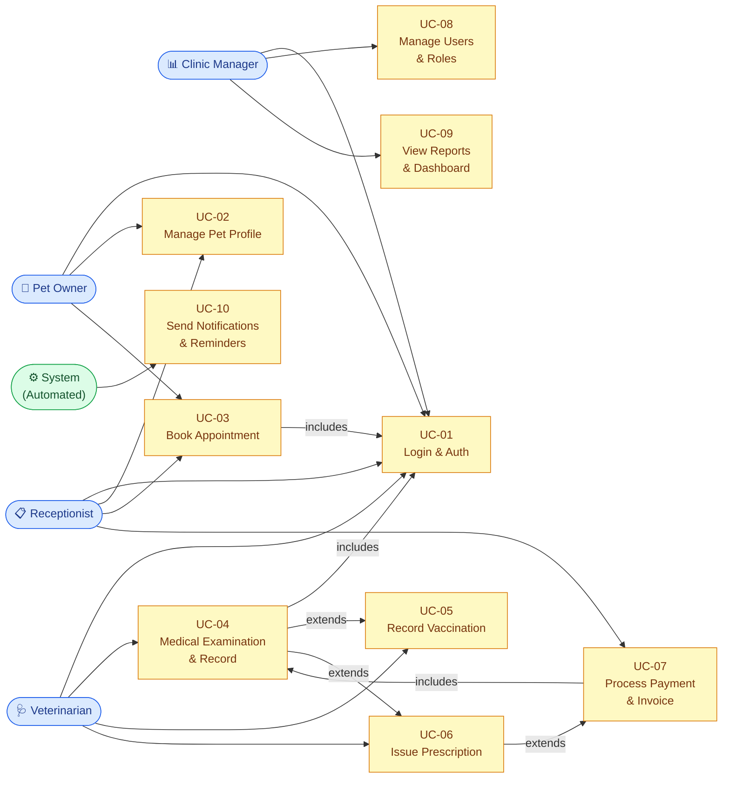
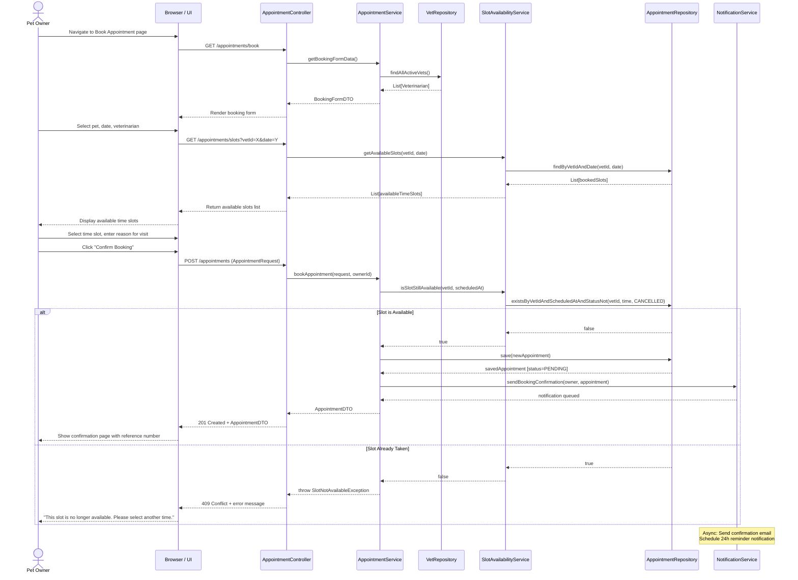
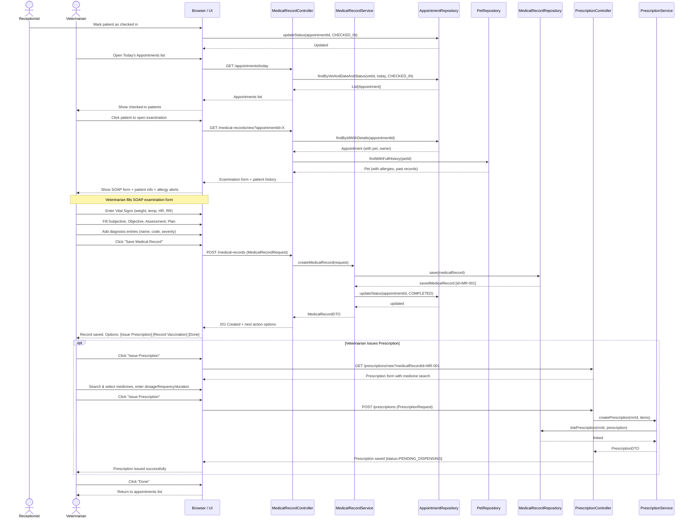
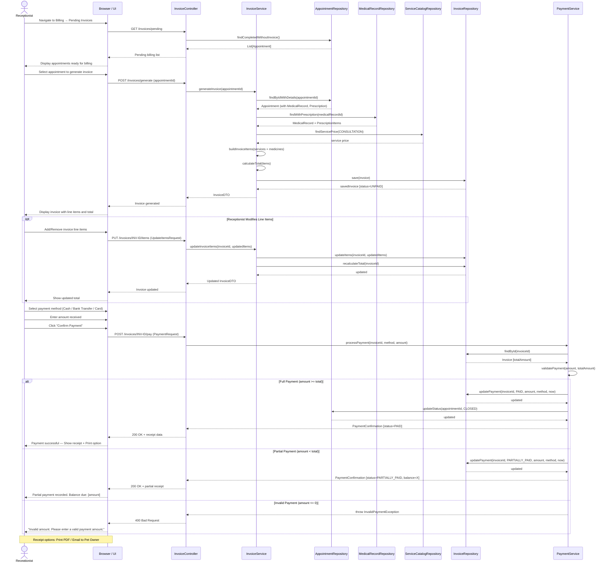
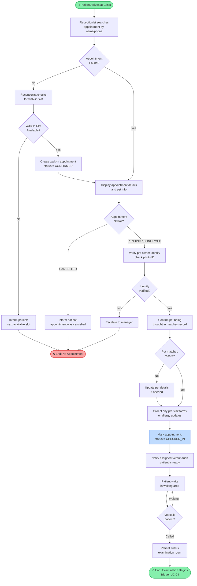
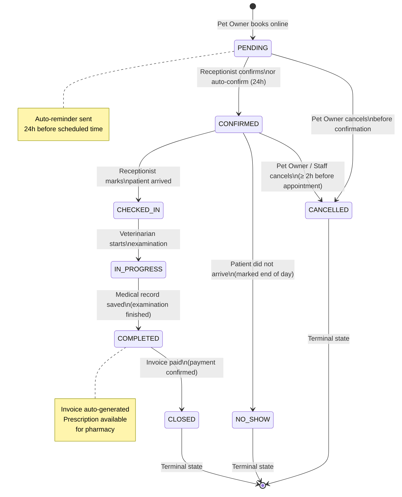

# Workflow Document 03 — UML Diagrams (Mermaid Code)
## VetCare Pro: Veterinary Clinic Management System

> **Status:** ✅ FINALIZED  
> **Last Updated:** 2026-11-04  
> **Tool:** Mermaid (render in VS Code with Markdown Preview Mermaid Support, or paste into https://mermaid.live)

---

## Diagram Index

| # | Diagram | Type | Use Cases |
|---|---------|------|-----------|
| D-01 | [Overall Use Case Overview](#d-01-overall-use-case-overview) | Flowchart (Use Case style) | All UCs |
| D-02 | [Class Diagram](#d-02-class-diagram) | `classDiagram` | All |
| D-03 | [Entity-Relationship Diagram (ERD)](#d-03-entity-relationship-diagram-erd) | `erDiagram` | All |
| D-04 | [Sequence Diagram — Book Appointment](#d-04-sequence-diagram--book-appointment-uc-03) | `sequenceDiagram` | UC-03 |
| D-05 | [Sequence Diagram — Medical Examination](#d-05-sequence-diagram--medical-examination--record-uc-04) | `sequenceDiagram` | UC-04 |
| D-06 | [Sequence Diagram — Process Payment](#d-06-sequence-diagram--process-payment--invoice-uc-07) | `sequenceDiagram` | UC-07 |
| D-07 | [Activity Diagram — Patient Check-in Flow](#d-07-activity-diagram--patient-check-in-flow) | `flowchart TD` | UC-03, UC-04 |
| D-08 | [State Diagram — Appointment Lifecycle](#d-08-state-diagram--appointment-lifecycle) | `stateDiagram-v2` | UC-03, UC-07 |

---

## D-01: Overall Use Case Overview

> Rendered as a structured flowchart since Mermaid does not have native use case diagram syntax.
> Oval shapes = Use Cases | Rectangle = Actors | Arrows = "can perform"

---

## D-02: Class Diagram

> Covers all core domain entities of the VetCare Pro system with attributes, methods, and relationships.

```mermaid
classDiagram
    direction TB

    class User {
        +Long id
        +String username
        +String email
        +String passwordHash
        +Boolean isActive
        +LocalDateTime createdAt
        +login() Boolean
        +logout() void
        +changePassword(newPwd) void
    }

    class PetOwner {
        +Long id
        +String fullName
        +String phone
        +String address
        +registerPet(pet) Pet
        +getMyPets() List~Pet~
    }

    class Veterinarian {
        +Long id
        +String fullName
        +String specialization
        +String licenseNumber
        +createMedicalRecord(record) MedicalRecord
        +issuePrescription(rx) Prescription
        +recordVaccination(vacc) Vaccination
        +getSchedule(date) List~Appointment~
    }

    class Receptionist {
        +Long id
        +String fullName
        +String employeeCode
        +createAppointment(apt) Appointment
        +checkInPatient(aptId) void
        +processPayment(invId) Invoice
    }

    class Pet {
        +Long id
        +String name
        +String species
        +String breed
        +LocalDate dateOfBirth
        +String gender
        +Double weight
        +String microchipId
        +String knownAllergies
        +String photo
        +getAge() Integer
        +getMedicalHistory() List~MedicalRecord~
        +getVaccinationStatus() List~Vaccination~
    }

    class Appointment {
        +Long id
        +LocalDateTime scheduledAt
        +AppointmentStatus status
        +String reasonForVisit
        +String notes
        +LocalDateTime createdAt
        +confirm() void
        +cancel(reason) void
        +checkIn() void
        +complete() void
    }

    class MedicalRecord {
        +Long id
        +LocalDateTime visitDate
        +String subjective
        +String objective
        +String assessment
        +String plan
        +Double weightKg
        +Double temperatureCelsius
        +Integer heartRateBpm
        +Integer respiratoryRate
        +String additionalNotes
        +getSummary() String
    }

    class Diagnosis {
        +Long id
        +String diagnosisName
        +String icdCode
        +String severity
        +String notes
        +Boolean isPrimary
    }

    class Prescription {
        +Long id
        +LocalDate issuedDate
        +LocalDate expiryDate
        +PrescriptionStatus status
        +String notes
        +getTotalCost() Double
    }

    class PrescriptionItem {
        +Long id
        +String dosage
        +String frequency
        +Integer durationDays
        +String instructions
        +Integer quantity
    }

    class Vaccination {
        +Long id
        +LocalDate administeredDate
        +LocalDate nextDueDate
        +String batchNumber
        +String notes
        +Boolean reminderSent
        +isOverdue() Boolean
        +getDaysUntilDue() Long
    }

    class Vaccine {
        +Long id
        +String name
        +String manufacturer
        +String description
        +Integer intervalDays
        +String targetSpecies
    }

    class Invoice {
        +Long id
        +LocalDateTime issuedAt
        +Double subtotal
        +Double tax
        +Double totalAmount
        +Double amountPaid
        +PaymentStatus paymentStatus
        +String paymentMethod
        +LocalDateTime paidAt
        +getBalance() Double
        +generatePDF() byte[]
    }

    class InvoiceItem {
        +Long id
        +String description
        +ItemType itemType
        +Integer quantity
        +Double unitPrice
        +Double subtotal
        +calculateSubtotal() Double
    }

    class Medicine {
        +Long id
        +String name
        +String activeIngredient
        +String dosageForm
        +String unit
        +Double unitPrice
        +Integer stockQuantity
        +Integer minStockThreshold
        +isLowStock() Boolean
        +adjustStock(qty) void
    }

    class Service {
        +Long id
        +String name
        +String category
        +String description
        +Double price
        +Boolean isActive
    }

    class Notification {
        +Long id
        +String type
        +String title
        +String message
        +LocalDateTime scheduledAt
        +Boolean isSent
        +String channel
        +send() void
    }

    %% Inheritance / Association: User ↔ Role Profiles
    User "1" --> "0..1" PetOwner : has profile
    User "1" --> "0..1" Veterinarian : has profile
    User "1" --> "0..1" Receptionist : has profile

    %% Ownership
    PetOwner "1" --> "1..*" Pet : owns
    PetOwner "1" --> "*" Appointment : books

    %% Appointment links
    Veterinarian "1" --> "*" Appointment : assigned to
    Pet "1" --> "*" Appointment : subject of
    Appointment "1" --> "0..1" MedicalRecord : generates
    Appointment "1" --> "0..1" Invoice : produces

    %% Medical Record links
    MedicalRecord "1" --> "1..*" Diagnosis : contains
    MedicalRecord "1" --> "0..1" Prescription : has

    %% Prescription links
    Prescription "1" --> "1..*" PrescriptionItem : includes
    PrescriptionItem "*" --> "1" Medicine : references

    %% Vaccination links
    Pet "1" --> "*" Vaccination : receives
    Vaccine "1" --> "*" Vaccination : used in
    Veterinarian "1" --> "*" Vaccination : administers

    %% Invoice links
    Invoice "1" --> "1..*" InvoiceItem : contains

    %% Notification
    User "1" --> "*" Notification : receives
```

---

## D-03: Entity-Relationship Diagram (ERD)

> Represents the relational database schema. Notation: `||--||` = one-to-one, `||--|{` = one-to-many, `}|--|{` = many-to-many.

```mermaid
erDiagram
    USERS {
        bigint id PK
        varchar username UK
        varchar email UK
        varchar password_hash
        boolean is_active
        datetime created_at
        datetime updated_at
    }

    ROLES {
        int id PK
        varchar name UK
        varchar description
    }

    USER_ROLES {
        bigint user_id FK
        int role_id FK
    }

    PET_OWNERS {
        bigint id PK
        bigint user_id FK
        varchar full_name
        varchar phone
        text address
        datetime created_at
    }

    VETERINARIANS {
        bigint id PK
        bigint user_id FK
        varchar full_name
        varchar specialization
        varchar license_number UK
        boolean is_available
    }

    RECEPTIONISTS {
        bigint id PK
        bigint user_id FK
        varchar full_name
        varchar employee_code UK
    }

    PETS {
        bigint id PK
        bigint owner_id FK
        varchar name
        varchar species
        varchar breed
        date date_of_birth
        varchar gender
        decimal weight
        varchar microchip_id UK
        text known_allergies
        varchar photo_url
        datetime created_at
    }

    APPOINTMENTS {
        bigint id PK
        bigint pet_id FK
        bigint vet_id FK
        bigint owner_id FK
        datetime scheduled_at
        varchar status
        text reason_for_visit
        text notes
        datetime created_at
        datetime updated_at
    }

    MEDICAL_RECORDS {
        bigint id PK
        bigint appointment_id FK "UNIQUE"
        datetime visit_date
        text subjective
        text objective
        text assessment
        text plan
        decimal weight_kg
        decimal temperature_celsius
        int heart_rate_bpm
        int respiratory_rate
        text additional_notes
        datetime created_at
    }

    DIAGNOSES {
        bigint id PK
        bigint medical_record_id FK
        varchar diagnosis_name
        varchar icd_code
        varchar severity
        text notes
        boolean is_primary
    }

    PRESCRIPTIONS {
        bigint id PK
        bigint medical_record_id FK "UNIQUE"
        date issued_date
        date expiry_date
        varchar status
        text notes
    }

    PRESCRIPTION_ITEMS {
        bigint id PK
        bigint prescription_id FK
        bigint medicine_id FK
        varchar dosage
        varchar frequency
        int duration_days
        text instructions
        int quantity
    }

    VACCINATIONS {
        bigint id PK
        bigint pet_id FK
        bigint vaccine_id FK
        bigint vet_id FK
        date administered_date
        date next_due_date
        varchar batch_number
        text notes
        boolean reminder_sent
    }

    VACCINES {
        bigint id PK
        varchar name UK
        varchar manufacturer
        text description
        int interval_days
        varchar target_species
    }

    MEDICINES {
        bigint id PK
        varchar name UK
        varchar active_ingredient
        varchar dosage_form
        varchar unit
        decimal unit_price
        int stock_quantity
        int min_stock_threshold
        boolean is_active
    }

    SERVICES {
        bigint id PK
        varchar name
        varchar category
        text description
        decimal price
        boolean is_active
    }

    INVOICES {
        bigint id PK
        bigint appointment_id FK "UNIQUE"
        datetime issued_at
        decimal subtotal
        decimal tax
        decimal total_amount
        decimal amount_paid
        varchar payment_status
        varchar payment_method
        datetime paid_at
    }

    INVOICE_ITEMS {
        bigint id PK
        bigint invoice_id FK
        varchar description
        varchar item_type
        int quantity
        decimal unit_price
        decimal subtotal
    }

    NOTIFICATIONS {
        bigint id PK
        bigint user_id FK
        varchar type
        varchar title
        text message
        datetime scheduled_at
        boolean is_sent
        varchar channel
        datetime sent_at
    }

    %% Relationships
    USERS ||--o| PET_OWNERS : "profiled as"
    USERS ||--o| VETERINARIANS : "profiled as"
    USERS ||--o| RECEPTIONISTS : "profiled as"
    USERS }o--o{ ROLES : "USER_ROLES"
    PET_OWNERS ||--|{ PETS : "owns"
    PET_OWNERS ||--|{ APPOINTMENTS : "books"
    VETERINARIANS ||--|{ APPOINTMENTS : "handles"
    PETS ||--|{ APPOINTMENTS : "subject of"
    APPOINTMENTS ||--o| MEDICAL_RECORDS : "generates"
    MEDICAL_RECORDS ||--|{ DIAGNOSES : "contains"
    MEDICAL_RECORDS ||--o| PRESCRIPTIONS : "has"
    PRESCRIPTIONS ||--|{ PRESCRIPTION_ITEMS : "includes"
    PRESCRIPTION_ITEMS }|--|| MEDICINES : "references"
    PETS ||--|{ VACCINATIONS : "receives"
    VACCINES ||--|{ VACCINATIONS : "used in"
    VETERINARIANS ||--|{ VACCINATIONS : "administers"
    APPOINTMENTS ||--o| INVOICES : "produces"
    INVOICES ||--|{ INVOICE_ITEMS : "contains"
    USERS ||--|{ NOTIFICATIONS : "receives"
```

---

## D-04: Sequence Diagram — Book Appointment (UC-03)

> **Actor:** Pet Owner | **Goal:** Successfully book a veterinary appointment online  
> Covers: happy path, slot conflict exception, confirmation notification

---

## D-05: Sequence Diagram — Medical Examination & Record (UC-04)

> **Actor:** Veterinarian | **Goal:** Record a complete medical examination in SOAP format  
> Covers: check-in, SOAP notes, diagnosis, optional prescription trigger, record finalization

---

## D-06: Sequence Diagram — Process Payment & Invoice (UC-07)

> **Actor:** Receptionist | **Goal:** Generate and finalize invoice, collect payment  
> Covers: auto invoice generation, line-item adjustment, payment processing, receipt

---

## D-07: Activity Diagram — Patient Check-in Flow

> Covers the end-to-end flow from patient arrival at clinic to start of examination.

---

## D-08: State Diagram — Appointment Lifecycle

> Shows all valid states an appointment can be in and the transitions between them.

---

## Rendering Instructions

### Option 1 — VS Code (Recommended)
1. Install extension: **Markdown Preview Mermaid Support** (`bierner.markdown-mermaid`)
2. Open any `.md` file → Press `Ctrl+Shift+V` to preview
3. All diagrams render inline

### Option 2 — Mermaid Live Editor
1. Go to https://mermaid.live
2. Copy any code block (without the triple backticks)
3. Paste into editor → diagram renders on right panel
4. Export as PNG/SVG for report

### Option 3 — GitHub
Push to GitHub repository — all Mermaid blocks auto-render in GitHub Markdown preview.

---

## Export Targets for Report

| Diagram | Export File | Insert in Report Section |
|---------|------------|--------------------------|
| D-01 Use Case Overview | `docs/uml/usecase-overview.png` | Section 4.1 — Use Case Diagram |
| D-02 Class Diagram | `docs/uml/class-diagram.png` | Section 4.2 — Class Diagram |
| D-03 ERD | `docs/uml/erd.png` | Section 4.2 — ERD / Section 5 — DB Design |
| D-04 Sequence — Booking | `docs/uml/seq-book-appointment.png` | Section 4.3 — Sequence Diagrams |
| D-05 Sequence — Examination | `docs/uml/seq-examination.png` | Section 4.3 — Sequence Diagrams |
| D-06 Sequence — Payment | `docs/uml/seq-payment.png` | Section 4.3 — Sequence Diagrams |
| D-07 Activity — Check-in | `docs/uml/activity-checkin.png` | Section 4.3 — Activity Diagrams |
| D-08 State — Appointment | `docs/uml/state-appointment.png` | Section 4.3 — State Diagrams |

---

*Next: → [`04_database_design.md`](./04_database_design.md) — Full Relational Schema & Data Dictionary*

