# 4. Thiết Kế Cơ Sở Dữ Liệu — Database Design

> **Dự án:** VetCare Pro — Hệ thống Quản lý Phòng khám Thú y  
> **Phiên bản:** 2.0  
> **Cập nhật lần cuối:** 04/11/2026  

---

## Mục lục

1. [Tổng quan Cơ sở dữ liệu (Database Overview)](#1-tổng-quan-cơ-sở-dữ-liệu)
2. [Lược đồ Quan hệ — Mô tả chi tiết bảng (Relational Schema)](#2-lược-đồ-quan-hệ--mô-tả-chi-tiết-bảng)
3. [Từ điển Dữ liệu (Data Dictionary)](#3-từ-điển-dữ-liệu)
4. [Ma trận Quan hệ (Relationship Summary Matrix)](#4-ma-trận-quan-hệ)
5. [Chiến lược Chỉ mục (Indexes Strategy)](#5-chiến-lược-chỉ-mục)
6. [ERD cập nhật (Updated ERD — Mermaid)](#6-erd-cập-nhật)

---

## 1. Tổng quan Cơ sở dữ liệu

| Thuộc tính | Giá trị |
|---|---|
| **Tên CSDL** | `vetcare_db` |
| **RDBMS** | MySQL 8.x |
| **Storage Engine** | InnoDB |
| **Character Set** | `utf8mb4` |
| **Collation** | `utf8mb4_unicode_ci` |
| **Tổng số bảng** | **23** |

### 1.1. Phân nhóm bảng theo Module

| # | Nhóm (Module) | Bảng | Mô tả |
|---|---|---|---|
| **A** | **Quản lý Tài khoản & Phân quyền** | `users`, `roles`, `user_roles` | Xác thực, phân quyền RBAC |
| **B** | **Hồ sơ Người dùng** | `pet_owners`, `veterinarians`, `receptionists` | Thông tin profile theo vai trò |
| **C** | **Quản lý Thú cưng** | `pets` | Hồ sơ bệnh nhân (thú cưng) |
| **D** | **Quản lý Lịch hẹn** | `appointments` | Đặt lịch, trạng thái cuộc hẹn |
| **E** | **Bệnh án & Chẩn đoán** | `medical_records`, `diagnoses` | Ghi nhận SOAP, mã ICD |
| **F** | **Đơn thuốc** | `prescriptions`, `prescription_items` | Kê đơn & chi tiết thuốc |
| **G** | **Tiêm phòng** | `vaccinations`, `vaccines` | Lịch sử tiêm, danh mục vaccine |
| **H** | **Danh mục Thuốc & Dịch vụ** | `medicines`, `services` | Kho thuốc, bảng giá dịch vụ |
| **I** | **Lịch làm việc Bác sĩ** *(Mở rộng)* | `vet_working_hours`, `vet_leaves` | Ca trực, nghỉ phép |
| **J** | **Thanh toán & Hóa đơn** | `invoices`, `invoice_items`, `service_price_history` | Xuất hóa đơn, lịch sử giá |
| **K** | **Kho & Tồn kho** *(Mở rộng)* | `stock_transactions` | Nhập/xuất/điều chỉnh tồn kho |
| **L** | **Thông báo** | `notifications` | Nhắc lịch hẹn, tiêm phòng |

---

## 2. Lược đồ Quan hệ — Mô tả chi tiết bảng

> [!NOTE]
> Mỗi bảng được mô tả đầy đủ bao gồm: cấu trúc cột, khóa chính, khóa ngoại, ràng buộc UNIQUE, INDEX, CHECK và các quy tắc nghiệp vụ.

---

### 2.1. Bảng `users` — Tài khoản hệ thống

> Lưu trữ thông tin đăng nhập cho tất cả người dùng hệ thống.

| Tên cột | Kiểu dữ liệu | Ràng buộc | Mặc định | Mô tả |
|---|---|---|---|---|
| `id` | `BIGINT` | `PRIMARY KEY`, `AUTO_INCREMENT` | — | Mã tài khoản |
| `username` | `VARCHAR(50)` | `UNIQUE`, `NOT NULL` | — | Tên đăng nhập |
| `email` | `VARCHAR(100)` | `UNIQUE`, `NOT NULL` | — | Địa chỉ email |
| `password_hash` | `VARCHAR(255)` | `NOT NULL` | — | Mật khẩu mã hóa (bcrypt) |
| `is_active` | `BOOLEAN` | — | `TRUE` | Trạng thái kích hoạt |
| `created_at` | `DATETIME` | — | `CURRENT_TIMESTAMP` | Ngày tạo |
| `updated_at` | `DATETIME` | — | `CURRENT_TIMESTAMP ON UPDATE CURRENT_TIMESTAMP` | Ngày cập nhật cuối |

- **Primary Key:** `id`
- **Unique Constraints:** `username`, `email`
- **Foreign Keys:** Không có
- **Indexes:** Tự động trên `username` (UNIQUE), `email` (UNIQUE)
- **Business Rules:**
  - Mật khẩu phải được hash bằng bcrypt trước khi lưu.
  - Soft-delete thông qua `is_active = FALSE` thay vì xóa vật lý.

---

### 2.2. Bảng `roles` — Định nghĩa vai trò

> Lưu trữ các vai trò trong hệ thống theo mô hình RBAC.

| Tên cột | Kiểu dữ liệu | Ràng buộc | Mặc định | Mô tả |
|---|---|---|---|---|
| `id` | `INT` | `PRIMARY KEY`, `AUTO_INCREMENT` | — | Mã vai trò |
| `name` | `VARCHAR(30)` | `UNIQUE`, `NOT NULL` | — | Tên vai trò |
| `description` | `VARCHAR(255)` | — | — | Mô tả vai trò |

- **Primary Key:** `id`
- **Unique Constraints:** `name`
- **Foreign Keys:** Không có
- **Business Rules:**
  - Hệ thống cố định 4 vai trò: `ADMIN`, `VETERINARIAN`, `RECEPTIONIST`, `PET_OWNER`.
  - Không cho phép xóa vai trò mặc định.

---

### 2.3. Bảng `user_roles` — Phân quyền người dùng

> Bảng trung gian quan hệ nhiều-nhiều giữa `users` và `roles`.

| Tên cột | Kiểu dữ liệu | Ràng buộc | Mặc định | Mô tả |
|---|---|---|---|---|
| `user_id` | `BIGINT` | `FK → users(id)`, `ON DELETE CASCADE` | — | Mã tài khoản |
| `role_id` | `INT` | `FK → roles(id)`, `ON DELETE CASCADE` | — | Mã vai trò |

- **Primary Key:** Composite `(user_id, role_id)`
- **Foreign Keys:**
  - `user_id` → `users(id)` `ON DELETE CASCADE`
  - `role_id` → `roles(id)` `ON DELETE CASCADE`
- **Business Rules:**
  - Mỗi user phải có ít nhất 1 vai trò.
  - Một user có thể có nhiều vai trò đồng thời (ví dụ: ADMIN + VETERINARIAN).

---

### 2.4. Bảng `pet_owners` — Hồ sơ chủ thú cưng

> Thông tin chi tiết của khách hàng (chủ thú cưng).

| Tên cột | Kiểu dữ liệu | Ràng buộc | Mặc định | Mô tả |
|---|---|---|---|---|
| `id` | `BIGINT` | `PRIMARY KEY`, `AUTO_INCREMENT` | — | Mã chủ thú cưng |
| `user_id` | `BIGINT` | `FK → users(id)`, `UNIQUE`, `NOT NULL` | — | Liên kết tài khoản |
| `full_name` | `VARCHAR(100)` | `NOT NULL` | — | Họ tên đầy đủ |
| `phone` | `VARCHAR(20)` | — | — | Số điện thoại |
| `address` | `TEXT` | — | — | Địa chỉ |
| `created_at` | `DATETIME` | — | `CURRENT_TIMESTAMP` | Ngày tạo |

- **Primary Key:** `id`
- **Unique Constraints:** `user_id` (mỗi user chỉ có 1 hồ sơ chủ thú cưng)
- **Foreign Keys:**
  - `user_id` → `users(id)`
- **Business Rules:**
  - Quan hệ 1:1 với `users` — mỗi tài khoản chủ thú cưng tương ứng một profile duy nhất.

---

### 2.5. Bảng `veterinarians` — Hồ sơ bác sĩ thú y

> Thông tin chuyên môn của bác sĩ thú y.

| Tên cột | Kiểu dữ liệu | Ràng buộc | Mặc định | Mô tả |
|---|---|---|---|---|
| `id` | `BIGINT` | `PRIMARY KEY`, `AUTO_INCREMENT` | — | Mã bác sĩ |
| `user_id` | `BIGINT` | `FK → users(id)`, `UNIQUE`, `NOT NULL` | — | Liên kết tài khoản |
| `full_name` | `VARCHAR(100)` | `NOT NULL` | — | Họ tên đầy đủ |
| `specialization` | `VARCHAR(100)` | — | — | Chuyên khoa |
| `license_number` | `VARCHAR(50)` | `UNIQUE`, `NOT NULL` | — | Số giấy phép hành nghề |
| `is_available` | `BOOLEAN` | — | `TRUE` | Trạng thái sẵn sàng |

- **Primary Key:** `id`
- **Unique Constraints:** `user_id`, `license_number`
- **Foreign Keys:**
  - `user_id` → `users(id)`
- **Business Rules:**
  - `license_number` phải duy nhất trong toàn hệ thống.
  - `is_available = FALSE` khi bác sĩ nghỉ phép hoặc không nhận ca.

---

### 2.6. Bảng `receptionists` — Hồ sơ lễ tân

> Thông tin nhân viên lễ tân.

| Tên cột | Kiểu dữ liệu | Ràng buộc | Mặc định | Mô tả |
|---|---|---|---|---|
| `id` | `BIGINT` | `PRIMARY KEY`, `AUTO_INCREMENT` | — | Mã lễ tân |
| `user_id` | `BIGINT` | `FK → users(id)`, `UNIQUE`, `NOT NULL` | — | Liên kết tài khoản |
| `full_name` | `VARCHAR(100)` | `NOT NULL` | — | Họ tên đầy đủ |
| `employee_code` | `VARCHAR(30)` | `UNIQUE`, `NOT NULL` | — | Mã nhân viên |

- **Primary Key:** `id`
- **Unique Constraints:** `user_id`, `employee_code`
- **Foreign Keys:**
  - `user_id` → `users(id)`
- **Business Rules:**
  - Mã nhân viên (`employee_code`) do hệ thống tự sinh hoặc admin cấp.

---

### 2.7. Bảng `pets` — Hồ sơ thú cưng (bệnh nhân)

> Hồ sơ chi tiết của mỗi thú cưng — là đối tượng chính của phòng khám.

| Tên cột | Kiểu dữ liệu | Ràng buộc | Mặc định | Mô tả |
|---|---|---|---|---|
| `id` | `BIGINT` | `PRIMARY KEY`, `AUTO_INCREMENT` | — | Mã thú cưng |
| `owner_id` | `BIGINT` | `FK → pet_owners(id)`, `NOT NULL` | — | Mã chủ sở hữu |
| `name` | `VARCHAR(100)` | `NOT NULL` | — | Tên thú cưng |
| `species` | `VARCHAR(50)` | `NOT NULL` | — | Loài (Chó, Mèo…) |
| `breed` | `VARCHAR(100)` | — | — | Giống |
| `date_of_birth` | `DATE` | — | — | Ngày sinh |
| `gender` | `VARCHAR(10)` | — | — | Giới tính: `MALE`, `FEMALE`, `UNKNOWN` |
| `weight` | `DECIMAL(5,2)` | — | — | Cân nặng (kg) |
| `microchip_id` | `VARCHAR(50)` | `UNIQUE` | — | Mã microchip |
| `known_allergies` | `TEXT` | — | — | Dị ứng đã biết |
| `photo_url` | `VARCHAR(500)` | — | — | URL ảnh đại diện |
| `created_at` | `DATETIME` | — | `CURRENT_TIMESTAMP` | Ngày tạo |

- **Primary Key:** `id`
- **Unique Constraints:** `microchip_id`
- **Foreign Keys:**
  - `owner_id` → `pet_owners(id)`
- **Indexes:** `owner_id` (FK index)
- **Business Rules:**
  - Một chủ có thể sở hữu nhiều thú cưng (1:N).
  - `gender` chấp nhận: `MALE`, `FEMALE`, `UNKNOWN`.
  - `species` thường là: `DOG`, `CAT`, `BIRD`, `RABBIT`, `HAMSTER`, `OTHER`.

---

### 2.8. Bảng `appointments` — Lịch hẹn khám

> Quản lý đặt lịch hẹn khám bệnh tại phòng khám.

| Tên cột | Kiểu dữ liệu | Ràng buộc | Mặc định | Mô tả |
|---|---|---|---|---|
| `id` | `BIGINT` | `PRIMARY KEY`, `AUTO_INCREMENT` | — | Mã lịch hẹn |
| `pet_id` | `BIGINT` | `FK → pets(id)`, `NOT NULL` | — | Mã thú cưng |
| `vet_id` | `BIGINT` | `FK → veterinarians(id)`, `NOT NULL` | — | Mã bác sĩ |
| `owner_id` | `BIGINT` | `FK → pet_owners(id)`, `NOT NULL` | — | Mã chủ thú cưng |
| `scheduled_at` | `DATETIME` | `NOT NULL` | — | Thời gian hẹn |
| `status` | `VARCHAR(20)` | — | `'PENDING'` | Trạng thái |
| `reason_for_visit` | `TEXT` | `NOT NULL` | — | Lý do khám |
| `notes` | `TEXT` | — | — | Ghi chú thêm |
| `created_at` | `DATETIME` | — | `CURRENT_TIMESTAMP` | Ngày tạo |
| `updated_at` | `DATETIME` | — | `CURRENT_TIMESTAMP ON UPDATE CURRENT_TIMESTAMP` | Ngày cập nhật |

- **Primary Key:** `id`
- **Foreign Keys:**
  - `pet_id` → `pets(id)`
  - `vet_id` → `veterinarians(id)`
  - `owner_id` → `pet_owners(id)`
- **Indexes:**
  - `idx_apt_vet_date (vet_id, scheduled_at)` — Tra cứu lịch bác sĩ theo ngày
  - `idx_apt_status (status)` — Lọc theo trạng thái
  - `idx_apt_owner (owner_id)` — Tra cứu lịch hẹn theo chủ thú cưng
- **Enum `status`:** `PENDING`, `CONFIRMED`, `CHECKED_IN`, `IN_PROGRESS`, `COMPLETED`, `CANCELLED`, `NO_SHOW`, `CLOSED`
- **Business Rules:**
  - Luồng trạng thái: `PENDING → CONFIRMED → CHECKED_IN → IN_PROGRESS → COMPLETED → CLOSED`.
  - Có thể `CANCELLED` hoặc `NO_SHOW` từ bất kỳ trạng thái nào trước `COMPLETED`.
  - Không cho phép đặt trùng slot (cùng `vet_id` + `scheduled_at`).

---

### 2.9. Bảng `medical_records` — Bệnh án (SOAP)

> Ghi nhận kết quả khám bệnh theo phương pháp SOAP.

| Tên cột | Kiểu dữ liệu | Ràng buộc | Mặc định | Mô tả |
|---|---|---|---|---|
| `id` | `BIGINT` | `PRIMARY KEY`, `AUTO_INCREMENT` | — | Mã bệnh án |
| `appointment_id` | `BIGINT` | `FK → appointments(id)`, `UNIQUE`, `NOT NULL` | — | Mã lịch hẹn liên kết |
| `visit_date` | `DATETIME` | `NOT NULL` | — | Ngày khám thực tế |
| `subjective` | `TEXT` | — | — | **S** — Chủ quan (triệu chứng chủ kể) |
| `objective` | `TEXT` | — | — | **O** — Khách quan (kết quả khám lâm sàng) |
| `assessment` | `TEXT` | — | — | **A** — Đánh giá (chẩn đoán sơ bộ) |
| `plan` | `TEXT` | — | — | **P** — Kế hoạch điều trị |
| `weight_kg` | `DECIMAL(5,2)` | — | — | Cân nặng (kg) |
| `temperature_celsius` | `DECIMAL(4,1)` | — | — | Thân nhiệt (°C) |
| `heart_rate_bpm` | `INT` | — | — | Nhịp tim (bpm) |
| `respiratory_rate` | `INT` | — | — | Nhịp thở (lần/phút) |
| `additional_notes` | `TEXT` | — | — | Ghi chú bổ sung |
| `created_at` | `DATETIME` | — | `CURRENT_TIMESTAMP` | Ngày tạo |

- **Primary Key:** `id`
- **Unique Constraints:** `appointment_id` (1 cuộc hẹn → 1 bệnh án)
- **Foreign Keys:**
  - `appointment_id` → `appointments(id)`
- **Business Rules:**
  - Mỗi cuộc hẹn chỉ tạo tối đa 1 bệnh án (quan hệ 1:1).
  - Bệnh án chỉ được tạo khi appointment ở trạng thái `IN_PROGRESS` hoặc `COMPLETED`.

---

### 2.10. Bảng `diagnoses` — Chẩn đoán

> Lưu trữ các chẩn đoán chi tiết gắn với một bệnh án.

| Tên cột | Kiểu dữ liệu | Ràng buộc | Mặc định | Mô tả |
|---|---|---|---|---|
| `id` | `BIGINT` | `PRIMARY KEY`, `AUTO_INCREMENT` | — | Mã chẩn đoán |
| `medical_record_id` | `BIGINT` | `FK → medical_records(id)`, `NOT NULL` | — | Mã bệnh án |
| `diagnosis_name` | `VARCHAR(200)` | `NOT NULL` | — | Tên bệnh/chẩn đoán |
| `icd_code` | `VARCHAR(20)` | — | — | Mã ICD (nếu có) |
| `severity` | `VARCHAR(20)` | — | — | Mức độ: `MILD`, `MODERATE`, `SEVERE`, `CRITICAL` |
| `notes` | `TEXT` | — | — | Ghi chú thêm |
| `is_primary` | `BOOLEAN` | — | `FALSE` | Chẩn đoán chính? |

- **Primary Key:** `id`
- **Foreign Keys:**
  - `medical_record_id` → `medical_records(id)`
- **Business Rules:**
  - Mỗi bệnh án có thể có nhiều chẩn đoán (1:N).
  - Nên có đúng 1 chẩn đoán với `is_primary = TRUE` cho mỗi bệnh án.

---

### 2.11. Bảng `prescriptions` — Đơn thuốc

> Header đơn thuốc, liên kết 1:1 với bệnh án.

| Tên cột | Kiểu dữ liệu | Ràng buộc | Mặc định | Mô tả |
|---|---|---|---|---|
| `id` | `BIGINT` | `PRIMARY KEY`, `AUTO_INCREMENT` | — | Mã đơn thuốc |
| `medical_record_id` | `BIGINT` | `FK → medical_records(id)`, `UNIQUE`, `NOT NULL` | — | Mã bệnh án |
| `issued_date` | `DATE` | `NOT NULL` | — | Ngày kê đơn |
| `expiry_date` | `DATE` | — | — | Ngày hết hạn đơn |
| `status` | `VARCHAR(30)` | — | `'PENDING_DISPENSING'` | Trạng thái đơn |
| `notes` | `TEXT` | — | — | Ghi chú |

- **Primary Key:** `id`
- **Unique Constraints:** `medical_record_id`
- **Foreign Keys:**
  - `medical_record_id` → `medical_records(id)`
- **Enum `status`:** `PENDING_DISPENSING`, `DISPENSED`, `CANCELLED`
- **Business Rules:**
  - Quan hệ 1:1 với `medical_records`.
  - Khi `DISPENSED`, hệ thống tự trừ tồn kho qua `stock_transactions`.

---

### 2.12. Bảng `prescription_items` — Chi tiết đơn thuốc

> Các dòng chi tiết trong một đơn thuốc.

| Tên cột | Kiểu dữ liệu | Ràng buộc | Mặc định | Mô tả |
|---|---|---|---|---|
| `id` | `BIGINT` | `PRIMARY KEY`, `AUTO_INCREMENT` | — | Mã dòng thuốc |
| `prescription_id` | `BIGINT` | `FK → prescriptions(id)`, `NOT NULL` | — | Mã đơn thuốc |
| `medicine_id` | `BIGINT` | `FK → medicines(id)`, `NOT NULL` | — | Mã thuốc |
| `dosage` | `VARCHAR(100)` | `NOT NULL` | — | Liều lượng |
| `frequency` | `VARCHAR(100)` | `NOT NULL` | — | Tần suất dùng |
| `duration_days` | `INT` | `NOT NULL` | — | Số ngày dùng |
| `instructions` | `TEXT` | — | — | Hướng dẫn sử dụng |
| `quantity` | `INT` | `NOT NULL` | — | Số lượng kê |

- **Primary Key:** `id`
- **Foreign Keys:**
  - `prescription_id` → `prescriptions(id)`
  - `medicine_id` → `medicines(id)`
- **Business Rules:**
  - `quantity` phải > 0.
  - `duration_days` phải > 0.

---

### 2.13. Bảng `vaccinations` — Lịch sử tiêm phòng

> Ghi nhận mỗi lần tiêm vaccine cho thú cưng.

| Tên cột | Kiểu dữ liệu | Ràng buộc | Mặc định | Mô tả |
|---|---|---|---|---|
| `id` | `BIGINT` | `PRIMARY KEY`, `AUTO_INCREMENT` | — | Mã tiêm phòng |
| `pet_id` | `BIGINT` | `FK → pets(id)`, `NOT NULL` | — | Mã thú cưng |
| `vaccine_id` | `BIGINT` | `FK → vaccines(id)`, `NOT NULL` | — | Mã vaccine |
| `vet_id` | `BIGINT` | `FK → veterinarians(id)`, `NOT NULL` | — | Bác sĩ thực hiện |
| `administered_date` | `DATE` | `NOT NULL` | — | Ngày tiêm |
| `next_due_date` | `DATE` | — | — | Ngày tiêm nhắc lại |
| `batch_number` | `VARCHAR(50)` | `NOT NULL` | — | Số lô vaccine |
| `notes` | `TEXT` | — | — | Ghi chú |
| `reminder_sent` | `BOOLEAN` | — | `FALSE` | Đã gửi nhắc lịch? |

- **Primary Key:** `id`
- **Foreign Keys:**
  - `pet_id` → `pets(id)`
  - `vaccine_id` → `vaccines(id)`
  - `vet_id` → `veterinarians(id)`
- **Business Rules:**
  - `next_due_date` tính từ `administered_date + vaccines.interval_days`.
  - Hệ thống tự set `reminder_sent = TRUE` sau khi gửi thông báo nhắc.

---

### 2.14. Bảng `vaccines` — Danh mục vaccine

> Danh mục các loại vaccine có sẵn tại phòng khám.

| Tên cột | Kiểu dữ liệu | Ràng buộc | Mặc định | Mô tả |
|---|---|---|---|---|
| `id` | `BIGINT` | `PRIMARY KEY`, `AUTO_INCREMENT` | — | Mã vaccine |
| `name` | `VARCHAR(100)` | `UNIQUE`, `NOT NULL` | — | Tên vaccine |
| `manufacturer` | `VARCHAR(200)` | — | — | Nhà sản xuất |
| `description` | `TEXT` | — | — | Mô tả / Chỉ định |
| `interval_days` | `INT` | — | — | Chu kỳ tiêm nhắc (ngày) |
| `target_species` | `VARCHAR(50)` | — | — | Loài đích: `DOG`, `CAT`, `BOTH`, `OTHER` |

- **Primary Key:** `id`
- **Unique Constraints:** `name`
- **Business Rules:**
  - `interval_days` dùng để tính `next_due_date` trong bảng `vaccinations`.

---

### 2.15. Bảng `medicines` — Danh mục thuốc

> Kho thuốc và vật tư y tế tại phòng khám.

| Tên cột | Kiểu dữ liệu | Ràng buộc | Mặc định | Mô tả |
|---|---|---|---|---|
| `id` | `BIGINT` | `PRIMARY KEY`, `AUTO_INCREMENT` | — | Mã thuốc |
| `name` | `VARCHAR(200)` | `UNIQUE`, `NOT NULL` | — | Tên thuốc |
| `active_ingredient` | `VARCHAR(200)` | — | — | Hoạt chất |
| `dosage_form` | `VARCHAR(50)` | — | — | Dạng bào chế |
| `unit` | `VARCHAR(30)` | `NOT NULL` | — | Đơn vị tính |
| `unit_price` | `DECIMAL(10,2)` | `NOT NULL`, `CHECK (unit_price >= 0)` | — | Đơn giá (VNĐ) |
| `stock_quantity` | `INT` | — | `0` | Số lượng tồn kho |
| `min_stock_threshold` | `INT` | — | `10` | Ngưỡng tồn kho tối thiểu |
| `is_active` | `BOOLEAN` | — | `TRUE` | Còn kinh doanh? |
| `expiry_date` | `DATE` | — | — | Hạn sử dụng |
| `last_restocked_at` | `DATETIME` | — | — | Lần nhập hàng cuối |
| `supplier_name` | `VARCHAR(200)` | — | — | Nhà cung cấp |

- **Primary Key:** `id`
- **Unique Constraints:** `name`
- **CHECK Constraints:** `unit_price >= 0`
- **Enum `dosage_form`:** `Tablet`, `Capsule`, `Injection`, `Syrup`, `Topical`
- **Business Rules:**
  - Cảnh báo khi `stock_quantity <= min_stock_threshold`.
  - Khi phát thuốc, `stock_quantity` giảm qua `stock_transactions`.

---

### 2.16. Bảng `services` — Danh mục dịch vụ

> Bảng giá và danh mục dịch vụ phòng khám.

| Tên cột | Kiểu dữ liệu | Ràng buộc | Mặc định | Mô tả |
|---|---|---|---|---|
| `id` | `BIGINT` | `PRIMARY KEY`, `AUTO_INCREMENT` | — | Mã dịch vụ |
| `name` | `VARCHAR(200)` | `NOT NULL` | — | Tên dịch vụ |
| `category` | `VARCHAR(30)` | `NOT NULL` | — | Danh mục |
| `description` | `TEXT` | — | — | Mô tả chi tiết |
| `price` | `DECIMAL(10,2)` | `NOT NULL`, `CHECK (price >= 0)` | — | Giá dịch vụ (VNĐ) |
| `duration_minutes` | `INT` | — | — | Thời lượng (phút) |
| `is_active` | `BOOLEAN` | — | `TRUE` | Còn cung cấp? |
| `updated_at` | `DATETIME` | — | `CURRENT_TIMESTAMP ON UPDATE CURRENT_TIMESTAMP` | Ngày cập nhật |

- **Primary Key:** `id`
- **CHECK Constraints:** `price >= 0`
- **Enum `category`:** `CONSULTATION`, `LAB_TEST`, `PROCEDURE`, `VACCINATION_SERVICE`, `GROOMING`, `OTHER`
- **Business Rules:**
  - Khi thay đổi giá, hệ thống tự ghi log vào `service_price_history`.

---

### 2.17. Bảng `invoices` — Hóa đơn

> Hóa đơn thanh toán cho mỗi cuộc hẹn khám.

| Tên cột | Kiểu dữ liệu | Ràng buộc | Mặc định | Mô tả |
|---|---|---|---|---|
| `id` | `BIGINT` | `PRIMARY KEY`, `AUTO_INCREMENT` | — | Mã hóa đơn |
| `appointment_id` | `BIGINT` | `FK → appointments(id)`, `UNIQUE`, `NOT NULL` | — | Mã lịch hẹn |
| `issued_at` | `DATETIME` | — | `CURRENT_TIMESTAMP` | Ngày phát hành |
| `subtotal` | `DECIMAL(12,2)` | — | `0` | Tổng phụ (trước thuế) |
| `tax` | `DECIMAL(12,2)` | — | `0` | Thuế |
| `total_amount` | `DECIMAL(12,2)` | — | `0` | Tổng cộng |
| `amount_paid` | `DECIMAL(12,2)` | — | `0` | Đã thanh toán |
| `payment_status` | `VARCHAR(20)` | — | `'UNPAID'` | Trạng thái thanh toán |
| `payment_method` | `VARCHAR(30)` | — | — | Phương thức thanh toán |
| `paid_at` | `DATETIME` | — | — | Thời điểm thanh toán |

- **Primary Key:** `id`
- **Unique Constraints:** `appointment_id`
- **Foreign Keys:**
  - `appointment_id` → `appointments(id)`
- **Enum `payment_status`:** `UNPAID`, `PAID`, `PARTIALLY_PAID`
- **Enum `payment_method`:** `CASH`, `BANK_TRANSFER`, `CARD`
- **Business Rules:**
  - `total_amount = subtotal + tax`.
  - `payment_status` tự cập nhật: `PAID` khi `amount_paid >= total_amount`, `PARTIALLY_PAID` khi `0 < amount_paid < total_amount`.

---

### 2.18. Bảng `invoice_items` — Chi tiết hóa đơn

> Các dòng chi tiết trong hóa đơn.

| Tên cột | Kiểu dữ liệu | Ràng buộc | Mặc định | Mô tả |
|---|---|---|---|---|
| `id` | `BIGINT` | `PRIMARY KEY`, `AUTO_INCREMENT` | — | Mã dòng |
| `invoice_id` | `BIGINT` | `FK → invoices(id)`, `NOT NULL` | — | Mã hóa đơn |
| `description` | `VARCHAR(300)` | `NOT NULL` | — | Mô tả mục |
| `item_type` | `VARCHAR(20)` | `NOT NULL` | — | Loại mục |
| `quantity` | `INT` | — | `1` | Số lượng |
| `unit_price` | `DECIMAL(10,2)` | `NOT NULL` | — | Đơn giá |
| `subtotal` | `DECIMAL(10,2)` | `NOT NULL` | — | Thành tiền |

- **Primary Key:** `id`
- **Foreign Keys:**
  - `invoice_id` → `invoices(id)`
- **Enum `item_type`:** `SERVICE`, `MEDICINE`, `LAB_TEST`, `OTHER`
- **Business Rules:**
  - `subtotal = quantity × unit_price`.

---

### 2.19. Bảng `notifications` — Thông báo

> Hàng đợi thông báo / nhắc lịch cho người dùng.

| Tên cột | Kiểu dữ liệu | Ràng buộc | Mặc định | Mô tả |
|---|---|---|---|---|
| `id` | `BIGINT` | `PRIMARY KEY`, `AUTO_INCREMENT` | — | Mã thông báo |
| `user_id` | `BIGINT` | `FK → users(id)`, `NOT NULL` | — | Người nhận |
| `type` | `VARCHAR(30)` | — | — | Loại thông báo |
| `title` | `VARCHAR(200)` | — | — | Tiêu đề |
| `message` | `TEXT` | — | — | Nội dung |
| `scheduled_at` | `DATETIME` | — | — | Thời điểm dự kiến gửi |
| `is_sent` | `BOOLEAN` | — | `FALSE` | Đã gửi? |
| `channel` | `VARCHAR(20)` | — | — | Kênh gửi |
| `sent_at` | `DATETIME` | — | — | Thời điểm gửi thực tế |

- **Primary Key:** `id`
- **Foreign Keys:**
  - `user_id` → `users(id)`
- **Enum `type`:** `APPOINTMENT_REMINDER`, `VACCINATION_DUE`, `SYSTEM_ALERT`
- **Enum `channel`:** `EMAIL`, `SMS`, `IN_APP`
- **Business Rules:**
  - Notification worker lấy các bản ghi có `is_sent = FALSE` và `scheduled_at <= NOW()` để gửi.
  - Sau khi gửi thành công: `is_sent = TRUE`, `sent_at = NOW()`.

---

### 2.20. Bảng `vet_working_hours` — Lịch làm việc bác sĩ *(Module I — Mở rộng)*

> Lịch trực hàng tuần của mỗi bác sĩ thú y.

| Tên cột | Kiểu dữ liệu | Ràng buộc | Mặc định | Mô tả |
|---|---|---|---|---|
| `id` | `BIGINT` | `PRIMARY KEY`, `AUTO_INCREMENT` | — | Mã bản ghi |
| `vet_id` | `BIGINT` | `FK → veterinarians(id)`, `NOT NULL` | — | Mã bác sĩ |
| `day_of_week` | `VARCHAR(10)` | `NOT NULL` | — | Thứ trong tuần |
| `start_time` | `TIME` | `NOT NULL` | — | Giờ bắt đầu |
| `end_time` | `TIME` | `NOT NULL` | — | Giờ kết thúc |
| `slot_duration_minutes` | `INT` | — | `30` | Thời lượng mỗi slot (phút) |
| `is_active` | `BOOLEAN` | — | `TRUE` | Đang áp dụng? |

- **Primary Key:** `id`
- **Unique Constraints:** `uk_vet_day (vet_id, day_of_week)` — mỗi bác sĩ chỉ 1 lịch/ngày
- **Foreign Keys:**
  - `vet_id` → `veterinarians(id)`
- **Enum `day_of_week`:** `MON`, `TUE`, `WED`, `THU`, `FRI`, `SAT`, `SUN`
- **Business Rules:**
  - `start_time < end_time`.
  - Số slot khả dụng = `(end_time - start_time) / slot_duration_minutes`.
  - Dùng kết hợp với `vet_leaves` để xác định slot trống khi đặt hẹn.

---

### 2.21. Bảng `vet_leaves` — Nghỉ phép bác sĩ *(Module I — Mở rộng)*

> Quản lý đơn nghỉ phép của bác sĩ thú y.

| Tên cột | Kiểu dữ liệu | Ràng buộc | Mặc định | Mô tả |
|---|---|---|---|---|
| `id` | `BIGINT` | `PRIMARY KEY`, `AUTO_INCREMENT` | — | Mã bản ghi |
| `vet_id` | `BIGINT` | `FK → veterinarians(id)`, `NOT NULL` | — | Mã bác sĩ |
| `leave_type` | `VARCHAR(20)` | `NOT NULL` | — | Loại nghỉ phép |
| `start_date` | `DATE` | `NOT NULL` | — | Ngày bắt đầu nghỉ |
| `end_date` | `DATE` | `NOT NULL` | — | Ngày kết thúc nghỉ |
| `reason` | `TEXT` | — | — | Lý do |
| `status` | `VARCHAR(20)` | — | `'PENDING'` | Trạng thái duyệt |
| `approved_by` | `BIGINT` | `FK → users(id)`, `NULL` | — | Người duyệt |

- **Primary Key:** `id`
- **Foreign Keys:**
  - `vet_id` → `veterinarians(id)`
  - `approved_by` → `users(id)` (nullable)
- **Enum `leave_type`:** `SICK`, `ANNUAL`, `EMERGENCY`, `OTHER`
- **Enum `status`:** `PENDING`, `APPROVED`, `REJECTED`
- **Business Rules:**
  - `start_date <= end_date`.
  - Khi `status = APPROVED`, hệ thống đánh dấu vet không available trong khoảng ngày đó.
  - Nếu đã có lịch hẹn trong khoảng nghỉ → cần thông báo hủy/chuyển bác sĩ.

---

### 2.22. Bảng `service_price_history` — Lịch sử thay đổi giá *(Module J — Mở rộng)*

> Ghi nhận mọi thay đổi giá dịch vụ để kiểm toán.

| Tên cột | Kiểu dữ liệu | Ràng buộc | Mặc định | Mô tả |
|---|---|---|---|---|
| `id` | `BIGINT` | `PRIMARY KEY`, `AUTO_INCREMENT` | — | Mã bản ghi |
| `service_id` | `BIGINT` | `FK → services(id)`, `NOT NULL` | — | Mã dịch vụ |
| `old_price` | `DECIMAL(10,2)` | `NOT NULL` | — | Giá cũ |
| `new_price` | `DECIMAL(10,2)` | `NOT NULL` | — | Giá mới |
| `changed_by` | `BIGINT` | `FK → users(id)`, `NOT NULL` | — | Người thay đổi |
| `changed_at` | `DATETIME` | — | `CURRENT_TIMESTAMP` | Thời điểm thay đổi |

- **Primary Key:** `id`
- **Foreign Keys:**
  - `service_id` → `services(id)`
  - `changed_by` → `users(id)`
- **Business Rules:**
  - Bản ghi được tạo tự động bởi application layer (hoặc trigger) khi cập nhật `services.price`.
  - Bảng chỉ INSERT, không cho phép UPDATE hoặc DELETE (append-only audit log).

---

### 2.23. Bảng `stock_transactions` — Giao dịch kho *(Module K — Mở rộng)*

> Ghi nhận mọi biến động tồn kho thuốc: nhập, xuất, điều chỉnh.

| Tên cột | Kiểu dữ liệu | Ràng buộc | Mặc định | Mô tả |
|---|---|---|---|---|
| `id` | `BIGINT` | `PRIMARY KEY`, `AUTO_INCREMENT` | — | Mã giao dịch |
| `medicine_id` | `BIGINT` | `FK → medicines(id)`, `NOT NULL` | — | Mã thuốc |
| `transaction_type` | `VARCHAR(30)` | `NOT NULL` | — | Loại giao dịch |
| `quantity_change` | `INT` | `NOT NULL` | — | Biến đổi SL (± ) |
| `quantity_after` | `INT` | `NOT NULL` | — | Tồn kho sau giao dịch |
| `reference_id` | `BIGINT` | — | — | FK → `prescription_items(id)` (nullable) |
| `batch_number` | `VARCHAR(50)` | — | — | Số lô |
| `expiry_date` | `DATE` | — | — | Hạn sử dụng lô |
| `supplier_name` | `VARCHAR(200)` | — | — | Nhà cung cấp |
| `unit_cost` | `DECIMAL(10,2)` | — | — | Giá nhập đơn vị |
| `notes` | `TEXT` | — | — | Ghi chú |
| `performed_by` | `BIGINT` | `FK → users(id)`, `NOT NULL` | — | Người thực hiện |
| `transaction_date` | `DATETIME` | — | `CURRENT_TIMESTAMP` | Thời điểm giao dịch |

- **Primary Key:** `id`
- **Foreign Keys:**
  - `medicine_id` → `medicines(id)`
  - `performed_by` → `users(id)`
  - `reference_id` → `prescription_items(id)` (soft FK — application level)
- **Enum `transaction_type`:** `STOCK_IN`, `DISPENSED`, `ADJUSTMENT_EXPIRED`, `ADJUSTMENT_DAMAGED`, `ADJUSTMENT_RETURNED`, `CORRECTION`
- **Business Rules:**
  - `quantity_change > 0` cho nhập hàng (`STOCK_IN`, `ADJUSTMENT_RETURNED`).
  - `quantity_change < 0` cho xuất hàng (`DISPENSED`, `ADJUSTMENT_EXPIRED`, `ADJUSTMENT_DAMAGED`).
  - `quantity_after` = `medicines.stock_quantity` sau khi áp dụng giao dịch.
  - Append-only: không cho phép UPDATE hoặc DELETE; dùng `CORRECTION` để sửa sai.

---

## 3. Từ điển Dữ liệu

### 3.1. `users`
**Mục đích:** Lưu trữ thông tin xác thực cho tất cả người dùng hệ thống, bao gồm admin, bác sĩ, lễ tân và chủ thú cưng. Đây là bảng trung tâm của hệ thống phân quyền.

**Quan hệ:** Là bảng cha của `user_roles`, `pet_owners`, `veterinarians`, `receptionists`, `notifications`. Được tham chiếu bởi `vet_leaves.approved_by`, `service_price_history.changed_by`, `stock_transactions.performed_by`.

### 3.2. `roles`
**Mục đích:** Định nghĩa các vai trò cố định trong hệ thống RBAC. Hệ thống khởi tạo với 4 vai trò:
- `ADMIN` — Quản trị viên toàn quyền
- `VETERINARIAN` — Bác sĩ thú y, truy cập bệnh án và kê đơn
- `RECEPTIONIST` — Lễ tân, quản lý lịch hẹn và hóa đơn
- `PET_OWNER` — Chủ thú cưng, đặt lịch và xem thông tin

### 3.3. `user_roles`
**Mục đích:** Bảng trung gian cho quan hệ N:N giữa `users` và `roles`, cho phép một tài khoản nắm giữ nhiều vai trò. Ví dụ: Admin kiêm Bác sĩ.

### 3.4. `pet_owners`
**Mục đích:** Profile mở rộng cho người dùng có vai trò `PET_OWNER`. Lưu họ tên, SĐT, địa chỉ liên lạc. Quan hệ 1:1 với `users`, 1:N với `pets` và `appointments`.

### 3.5. `veterinarians`
**Mục đích:** Profile chuyên môn cho bác sĩ thú y: chuyên khoa, số giấy phép, trạng thái sẵn sàng. Quan hệ 1:1 với `users`, 1:N với `appointments`, `vaccinations`, `vet_working_hours`, `vet_leaves`.

### 3.6. `receptionists`
**Mục đích:** Profile cho nhân viên lễ tân, bao gồm mã nhân viên nội bộ. Quan hệ 1:1 với `users`.

### 3.7. `pets`
**Mục đích:** Hồ sơ bệnh nhân (thú cưng) — đối tượng trung tâm của phòng khám. Bao gồm thông tin sinh học (loài, giống, giới tính, cân nặng), nhận dạng (microchip), dị ứng và ảnh. Mỗi thú cưng thuộc về đúng 1 chủ (`pet_owners`). Là bảng cha của `appointments` và `vaccinations`.

### 3.8. `appointments`
**Mục đích:** Quản lý vòng đời cuộc hẹn khám từ khi đặt đến khi đóng. Trạng thái theo luồng: `PENDING → CONFIRMED → CHECKED_IN → IN_PROGRESS → COMPLETED → CLOSED`. Liên kết 3 thực thể: pet, vet, owner. Là bảng cha của `medical_records` và `invoices` (quan hệ 1:1).

**Ý nghĩa các trạng thái:**
| Trạng thái | Mô tả |
|---|---|
| `PENDING` | Mới tạo, chờ xác nhận |
| `CONFIRMED` | Đã xác nhận bởi phòng khám |
| `CHECKED_IN` | Khách đã đến, check-in tại quầy |
| `IN_PROGRESS` | Đang khám |
| `COMPLETED` | Khám xong |
| `CANCELLED` | Đã hủy |
| `NO_SHOW` | Khách không đến |
| `CLOSED` | Đã thanh toán & đóng hồ sơ |

### 3.9. `medical_records`
**Mục đích:** Bệnh án theo mô hình SOAP (Subjective — Objective — Assessment — Plan), là chuẩn quốc tế cho ghi nhận lâm sàng. Kèm các chỉ số sinh tồn: cân nặng, thân nhiệt, nhịp tim, nhịp thở. Quan hệ 1:1 với `appointments`.

### 3.10. `diagnoses`
**Mục đích:** Chi tiết chẩn đoán cho mỗi bệnh án, hỗ trợ mã ICD (International Classification of Diseases). Cho phép nhiều chẩn đoán đồng thời, với `is_primary` đánh dấu chẩn đoán chính.

**Ý nghĩa mức độ nghiêm trọng (`severity`):**
| Giá trị | Mô tả |
|---|---|
| `MILD` | Nhẹ — theo dõi tại nhà |
| `MODERATE` | Trung bình — cần điều trị |
| `SEVERE` | Nặng — cần can thiệp tích cực |
| `CRITICAL` | Nguy kịch — cần cấp cứu |

### 3.11. `prescriptions`
**Mục đích:** Header đơn thuốc, gắn 1:1 với bệnh án. Quản lý trạng thái kê đơn → phát thuốc. `PENDING_DISPENSING` chờ nhà thuốc phát, `DISPENSED` đã phát, `CANCELLED` đã hủy.

### 3.12. `prescription_items`
**Mục đích:** Các dòng thuốc trong đơn: thuốc nào, liều bao nhiêu, bao lâu, hướng dẫn sử dụng. Liên kết đến `medicines` để kiểm tra tồn kho và đơn giá.

### 3.13. `vaccinations`
**Mục đích:** Sổ tiêm chủng cho từng thú cưng. Ghi nhận ngày tiêm, lô vaccine, bác sĩ thực hiện và ngày tiêm nhắc lại. `reminder_sent` hỗ trợ hệ thống nhắc tự động.

### 3.14. `vaccines`
**Mục đích:** Danh mục vaccine, bao gồm nhà sản xuất, chu kỳ tiêm nhắc (`interval_days`) và loài đích (`target_species`). Đây là master data, ít thay đổi.

### 3.15. `medicines`
**Mục đích:** Danh mục thuốc/vật tư y tế, tích hợp quản lý tồn kho. `stock_quantity` cập nhật qua `stock_transactions`. Hệ thống cảnh báo khi `stock_quantity <= min_stock_threshold`.

**Ý nghĩa `dosage_form`:**
| Giá trị | Mô tả |
|---|---|
| `Tablet` | Viên nén |
| `Capsule` | Viên nang |
| `Injection` | Dung dịch tiêm |
| `Syrup` | Siro |
| `Topical` | Thuốc bôi ngoài da |

### 3.16. `services`
**Mục đích:** Bảng giá dịch vụ phòng khám. Mỗi dịch vụ thuộc một `category` và có thời lượng ước tính. Khi thay đổi giá, lịch sử được ghi vào `service_price_history`.

### 3.17. `invoices`
**Mục đích:** Hóa đơn thanh toán, gắn 1:1 với cuộc hẹn. Hỗ trợ thanh toán một phần (`PARTIALLY_PAID`). `total_amount = subtotal + tax`.

### 3.18. `invoice_items`
**Mục đích:** Chi tiết từng dòng hóa đơn — dịch vụ, thuốc, xét nghiệm. `subtotal = quantity × unit_price`.

### 3.19. `notifications`
**Mục đích:** Hàng đợi thông báo đa kênh (Email, SMS, In-app). Worker xử lý bất đồng bộ: quét `is_sent = FALSE AND scheduled_at <= NOW()`, gửi và đánh dấu `is_sent = TRUE`.

### 3.20. `vet_working_hours`
**Mục đích:** Lịch trực hàng tuần cho mỗi bác sĩ, xác định khung giờ và thời lượng slot. Dùng để tính toán slot khả dụng khi đặt hẹn. Mỗi bác sĩ chỉ có 1 bản ghi/ngày trong tuần (UNIQUE `vet_id + day_of_week`).

### 3.21. `vet_leaves`
**Mục đích:** Quản lý đơn nghỉ phép bác sĩ: bệnh, phép năm, khẩn cấp. Có quy trình duyệt (`PENDING → APPROVED/REJECTED`). Nghỉ phép được duyệt sẽ block slot đặt hẹn trong khoảng ngày đó.

### 3.22. `service_price_history`
**Mục đích:** Audit trail cho mọi thay đổi giá dịch vụ. Append-only — chỉ INSERT, không UPDATE/DELETE. Ghi nhận ai thay đổi, khi nào, giá cũ/mới. Hữu ích cho báo cáo và kiểm toán.

### 3.23. `stock_transactions`
**Mục đích:** Sổ cái kho thuốc, ghi nhận mọi biến động: nhập hàng, phát thuốc, điều chỉnh (hết hạn, hư hỏng, trả lại, sửa sai). Append-only — dùng `CORRECTION` để sửa lỗi thay vì sửa trực tiếp. `quantity_after` giúp truy vết tồn kho tại mọi thời điểm.

---

## 4. Ma trận Quan hệ

### 4.1. Bảng tổng hợp Foreign Key

| # | Bảng cha (Parent) | Bảng con (Child) | Cột FK | Quan hệ | ON DELETE |
|---|---|---|---|---|---|
| 1 | `users` | `user_roles` | `user_id` | 1:N | `CASCADE` |
| 2 | `roles` | `user_roles` | `role_id` | 1:N | `CASCADE` |
| 3 | `users` | `pet_owners` | `user_id` | 1:1 | — |
| 4 | `users` | `veterinarians` | `user_id` | 1:1 | — |
| 5 | `users` | `receptionists` | `user_id` | 1:1 | — |
| 6 | `users` | `notifications` | `user_id` | 1:N | — |
| 7 | `users` | `vet_leaves` | `approved_by` | N:1 | — |
| 8 | `users` | `service_price_history` | `changed_by` | N:1 | — |
| 9 | `users` | `stock_transactions` | `performed_by` | N:1 | — |
| 10 | `pet_owners` | `pets` | `owner_id` | 1:N | — |
| 11 | `pet_owners` | `appointments` | `owner_id` | 1:N | — |
| 12 | `veterinarians` | `appointments` | `vet_id` | 1:N | — |
| 13 | `veterinarians` | `vaccinations` | `vet_id` | 1:N | — |
| 14 | `veterinarians` | `vet_working_hours` | `vet_id` | 1:N | — |
| 15 | `veterinarians` | `vet_leaves` | `vet_id` | 1:N | — |
| 16 | `pets` | `appointments` | `pet_id` | 1:N | — |
| 17 | `pets` | `vaccinations` | `pet_id` | 1:N | — |
| 18 | `appointments` | `medical_records` | `appointment_id` | 1:1 | — |
| 19 | `appointments` | `invoices` | `appointment_id` | 1:1 | — |
| 20 | `medical_records` | `diagnoses` | `medical_record_id` | 1:N | — |
| 21 | `medical_records` | `prescriptions` | `medical_record_id` | 1:1 | — |
| 22 | `prescriptions` | `prescription_items` | `prescription_id` | 1:N | — |
| 23 | `medicines` | `prescription_items` | `medicine_id` | 1:N | — |
| 24 | `medicines` | `stock_transactions` | `medicine_id` | 1:N | — |
| 25 | `vaccines` | `vaccinations` | `vaccine_id` | 1:N | — |
| 26 | `invoices` | `invoice_items` | `invoice_id` | 1:N | — |
| 27 | `services` | `service_price_history` | `service_id` | 1:N | — |

### 4.2. Sơ đồ phụ thuộc (Dependency Order)

Thứ tự tạo bảng phải tuân theo chuỗi phụ thuộc (parent trước child):

```
Level 0 (Không phụ thuộc):
  → users, roles, vaccines, medicines, services

Level 1 (Phụ thuộc Level 0):
  → user_roles, pet_owners, veterinarians, receptionists, notifications
  → service_price_history, stock_transactions

Level 2 (Phụ thuộc Level 1):
  → pets, vet_working_hours, vet_leaves

Level 3 (Phụ thuộc Level 2):
  → appointments, vaccinations

Level 4 (Phụ thuộc Level 3):
  → medical_records, invoices

Level 5 (Phụ thuộc Level 4):
  → diagnoses, prescriptions, invoice_items

Level 6 (Phụ thuộc Level 5):
  → prescription_items
```

---

## 5. Chiến lược Chỉ mục

> [!TIP]
> Indexes được thiết kế để tối ưu các truy vấn phổ biến nhất, cân bằng giữa tốc độ đọc và chi phí ghi.

### 5.1. Danh sách Indexes

| # | Bảng | Tên Index | Cột | Loại | Lý do |
|---|---|---|---|---|---|
| 1 | `users` | `uk_username` | `username` | UNIQUE | Đăng nhập: WHERE username = ? |
| 2 | `users` | `uk_email` | `email` | UNIQUE | Tìm kiếm email, khôi phục mật khẩu |
| 3 | `roles` | `uk_role_name` | `name` | UNIQUE | Tra cứu vai trò theo tên |
| 4 | `pet_owners` | `uk_po_user` | `user_id` | UNIQUE | Join 1:1 với users |
| 5 | `veterinarians` | `uk_vet_user` | `user_id` | UNIQUE | Join 1:1 với users |
| 6 | `veterinarians` | `uk_license` | `license_number` | UNIQUE | Tra cứu giấy phép |
| 7 | `receptionists` | `uk_rec_user` | `user_id` | UNIQUE | Join 1:1 với users |
| 8 | `receptionists` | `uk_emp_code` | `employee_code` | UNIQUE | Tra cứu mã nhân viên |
| 9 | `pets` | `idx_pets_owner` | `owner_id` | INDEX | Liệt kê thú cưng theo chủ |
| 10 | `pets` | `uk_microchip` | `microchip_id` | UNIQUE | Tra cứu microchip |
| 11 | `appointments` | `idx_apt_vet_date` | `(vet_id, scheduled_at)` | COMPOSITE | Lịch bác sĩ theo ngày — query chính cho module lịch |
| 12 | `appointments` | `idx_apt_status` | `status` | INDEX | Dashboard: lọc theo trạng thái |
| 13 | `appointments` | `idx_apt_owner` | `owner_id` | INDEX | Lịch sử hẹn của chủ thú cưng |
| 14 | `medical_records` | `uk_mr_appointment` | `appointment_id` | UNIQUE | Join 1:1 với appointments |
| 15 | `diagnoses` | `idx_diag_mr` | `medical_record_id` | INDEX | Chẩn đoán theo bệnh án |
| 16 | `prescriptions` | `uk_presc_mr` | `medical_record_id` | UNIQUE | Join 1:1 với medical_records |
| 17 | `prescription_items` | `idx_pi_presc` | `prescription_id` | INDEX | Chi tiết đơn thuốc |
| 18 | `prescription_items` | `idx_pi_medicine` | `medicine_id` | INDEX | Tra cứu thuốc đã kê |
| 19 | `vaccinations` | `idx_vacc_pet` | `pet_id` | INDEX | Lịch sử tiêm theo thú cưng |
| 20 | `vaccinations` | `idx_vacc_due` | `next_due_date` | INDEX | Lọc tiêm sắp đến hạn (nhắc lịch) |
| 21 | `vaccines` | `uk_vaccine_name` | `name` | UNIQUE | Tra cứu theo tên vaccine |
| 22 | `medicines` | `uk_medicine_name` | `name` | UNIQUE | Tra cứu theo tên thuốc |
| 23 | `invoices` | `uk_inv_appointment` | `appointment_id` | UNIQUE | Join 1:1 với appointments |
| 24 | `invoice_items` | `idx_ii_invoice` | `invoice_id` | INDEX | Chi tiết hóa đơn |
| 25 | `notifications` | `idx_notif_user` | `user_id` | INDEX | Thông báo theo người dùng |
| 26 | `notifications` | `idx_notif_pending` | `(is_sent, scheduled_at)` | COMPOSITE | Worker lấy thông báo chưa gửi |
| 27 | `vet_working_hours` | `uk_vet_day` | `(vet_id, day_of_week)` | UNIQUE | Lịch trực duy nhất mỗi ngày |
| 28 | `vet_leaves` | `idx_vl_vet_dates` | `(vet_id, start_date, end_date)` | COMPOSITE | Kiểm tra trùng nghỉ phép |
| 29 | `service_price_history` | `idx_sph_service` | `service_id` | INDEX | Lịch sử giá theo dịch vụ |
| 30 | `stock_transactions` | `idx_st_medicine` | `medicine_id` | INDEX | Lịch sử giao dịch theo thuốc |
| 31 | `stock_transactions` | `idx_st_date` | `transaction_date` | INDEX | Tra cứu giao dịch theo thời gian |

### 5.2. Nguyên tắc đánh Index

1. **Primary Key** — InnoDB tự tạo clustered index trên PK.
2. **Foreign Key** — MySQL tự tạo index trên FK columns (nếu chưa có).
3. **UNIQUE constraints** — Tự tạo unique index.
4. **Composite indexes** — Đặt cột có selectivity cao trước (ví dụ: `vet_id` trước `scheduled_at`).
5. **Covering indexes** — Ưu tiên cho các query chỉ SELECT từ cột đã index (index-only scan).

---

## 6. ERD cập nhật

> [!IMPORTANT]
> ERD dưới đây bao gồm đầy đủ **23 bảng** (19 bảng gốc + 4 bảng mở rộng Module I/J/K).

```mermaid
erDiagram
    users {
        BIGINT id PK
        VARCHAR username UK
        VARCHAR email UK
        VARCHAR password_hash
        BOOLEAN is_active
        DATETIME created_at
        DATETIME updated_at
    }

    roles {
        INT id PK
        VARCHAR name UK
        VARCHAR description
    }

    user_roles {
        BIGINT user_id FK
        INT role_id FK
    }

    pet_owners {
        BIGINT id PK
        BIGINT user_id FK, UK
        VARCHAR full_name
        VARCHAR phone
        TEXT address
        DATETIME created_at
    }

    veterinarians {
        BIGINT id PK
        BIGINT user_id FK, UK
        VARCHAR full_name
        VARCHAR specialization
        VARCHAR license_number UK
        BOOLEAN is_available
    }

    receptionists {
        BIGINT id PK
        BIGINT user_id FK, UK
        VARCHAR full_name
        VARCHAR employee_code UK
    }

    pets {
        BIGINT id PK
        BIGINT owner_id FK
        VARCHAR name
        VARCHAR species
        VARCHAR breed
        DATE date_of_birth
        VARCHAR gender
        DECIMAL weight
        VARCHAR microchip_id UK
        TEXT known_allergies
        VARCHAR photo_url
        DATETIME created_at
    }

    appointments {
        BIGINT id PK
        BIGINT pet_id FK
        BIGINT vet_id FK
        BIGINT owner_id FK
        DATETIME scheduled_at
        VARCHAR status
        TEXT reason_for_visit
        TEXT notes
        DATETIME created_at
        DATETIME updated_at
    }

    medical_records {
        BIGINT id PK
        BIGINT appointment_id FK, UK
        DATETIME visit_date
        TEXT subjective
        TEXT objective
        TEXT assessment
        TEXT plan
        DECIMAL weight_kg
        DECIMAL temperature_celsius
        INT heart_rate_bpm
        INT respiratory_rate
        TEXT additional_notes
        DATETIME created_at
    }

    diagnoses {
        BIGINT id PK
        BIGINT medical_record_id FK
        VARCHAR diagnosis_name
        VARCHAR icd_code
        VARCHAR severity
        TEXT notes
        BOOLEAN is_primary
    }

    prescriptions {
        BIGINT id PK
        BIGINT medical_record_id FK, UK
        DATE issued_date
        DATE expiry_date
        VARCHAR status
        TEXT notes
    }

    prescription_items {
        BIGINT id PK
        BIGINT prescription_id FK
        BIGINT medicine_id FK
        VARCHAR dosage
        VARCHAR frequency
        INT duration_days
        TEXT instructions
        INT quantity
    }

    vaccinations {
        BIGINT id PK
        BIGINT pet_id FK
        BIGINT vaccine_id FK
        BIGINT vet_id FK
        DATE administered_date
        DATE next_due_date
        VARCHAR batch_number
        TEXT notes
        BOOLEAN reminder_sent
    }

    vaccines {
        BIGINT id PK
        VARCHAR name UK
        VARCHAR manufacturer
        TEXT description
        INT interval_days
        VARCHAR target_species
    }

    medicines {
        BIGINT id PK
        VARCHAR name UK
        VARCHAR active_ingredient
        VARCHAR dosage_form
        VARCHAR unit
        DECIMAL unit_price
        INT stock_quantity
        INT min_stock_threshold
        BOOLEAN is_active
        DATE expiry_date
        DATETIME last_restocked_at
        VARCHAR supplier_name
    }

    services {
        BIGINT id PK
        VARCHAR name
        VARCHAR category
        TEXT description
        DECIMAL price
        INT duration_minutes
        BOOLEAN is_active
        DATETIME updated_at
    }

    invoices {
        BIGINT id PK
        BIGINT appointment_id FK, UK
        DATETIME issued_at
        DECIMAL subtotal
        DECIMAL tax
        DECIMAL total_amount
        DECIMAL amount_paid
        VARCHAR payment_status
        VARCHAR payment_method
        DATETIME paid_at
    }

    invoice_items {
        BIGINT id PK
        BIGINT invoice_id FK
        VARCHAR description
        VARCHAR item_type
        INT quantity
        DECIMAL unit_price
        DECIMAL subtotal
    }

    notifications {
        BIGINT id PK
        BIGINT user_id FK
        VARCHAR type
        VARCHAR title
        TEXT message
        DATETIME scheduled_at
        BOOLEAN is_sent
        VARCHAR channel
        DATETIME sent_at
    }

    vet_working_hours {
        BIGINT id PK
        BIGINT vet_id FK
        VARCHAR day_of_week
        TIME start_time
        TIME end_time
        INT slot_duration_minutes
        BOOLEAN is_active
    }

    vet_leaves {
        BIGINT id PK
        BIGINT vet_id FK
        VARCHAR leave_type
        DATE start_date
        DATE end_date
        TEXT reason
        VARCHAR status
        BIGINT approved_by FK
    }

    service_price_history {
        BIGINT id PK
        BIGINT service_id FK
        DECIMAL old_price
        DECIMAL new_price
        BIGINT changed_by FK
        DATETIME changed_at
    }

    stock_transactions {
        BIGINT id PK
        BIGINT medicine_id FK
        VARCHAR transaction_type
        INT quantity_change
        INT quantity_after
        BIGINT reference_id
        VARCHAR batch_number
        DATE expiry_date
        VARCHAR supplier_name
        DECIMAL unit_cost
        TEXT notes
        BIGINT performed_by FK
        DATETIME transaction_date
    }

    %% Relationships
    users ||--o{ user_roles : "has"
    roles ||--o{ user_roles : "assigned to"
    users ||--o| pet_owners : "profile"
    users ||--o| veterinarians : "profile"
    users ||--o| receptionists : "profile"
    users ||--o{ notifications : "receives"

    pet_owners ||--o{ pets : "owns"
    pet_owners ||--o{ appointments : "books"

    veterinarians ||--o{ appointments : "attends"
    veterinarians ||--o{ vaccinations : "administers"
    veterinarians ||--o{ vet_working_hours : "has schedule"
    veterinarians ||--o{ vet_leaves : "takes leave"

    pets ||--o{ appointments : "visited in"
    pets ||--o{ vaccinations : "receives"

    appointments ||--o| medical_records : "produces"
    appointments ||--o| invoices : "billed via"

    medical_records ||--o{ diagnoses : "contains"
    medical_records ||--o| prescriptions : "leads to"

    prescriptions ||--o{ prescription_items : "includes"
    medicines ||--o{ prescription_items : "prescribed in"
    medicines ||--o{ stock_transactions : "tracked by"

    vaccines ||--o{ vaccinations : "used in"

    invoices ||--o{ invoice_items : "contains"

    services ||--o{ service_price_history : "price logged"
    users ||--o{ service_price_history : "changed by"
    users ||--o{ stock_transactions : "performed by"
    users ||--o{ vet_leaves : "approves"
```



---

> **Kết thúc tài liệu Thiết kế Cơ sở dữ liệu — VetCare Pro v2.0**
